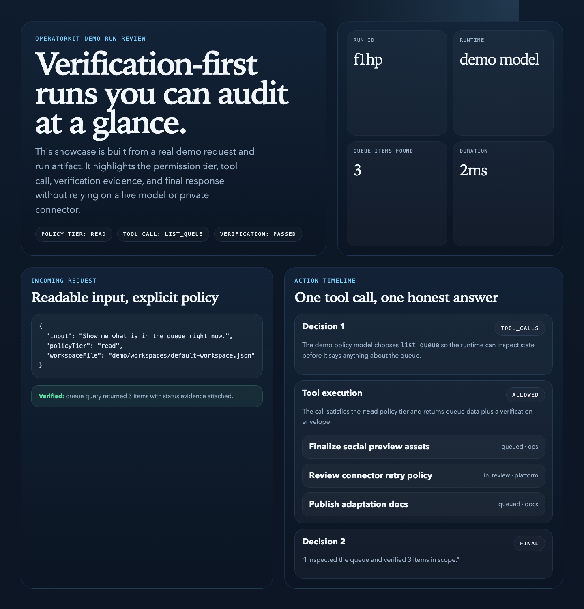

# Operatorkit

`operatorkit` is a verification-first runtime for tool-using agents. It is designed for builders who want hard permission checks, schema-validated tool calls, auditable execution, and a runtime that refuses to confirm work it cannot verify.

It is designed as a standalone runtime: explicit architecture, synthetic examples, and a clean adaptation path for personal or team use without hidden connectors, proprietary prompts, or embedded operational context.



Showcase capture built from the committed demo request and run artifacts, so the README leads with a real runtime trace instead of a mockup.

## Status

The current release focuses on a small but credible public-safe runtime core.

The current goal is to establish:
- a clean repo history
- a safe OSS baseline
- a small but credible runtime core
- a clear permission and verification story
- demo-safe tools and adaptation docs

What already exists:
- a bounded multi-turn runtime loop
- policy-gated tool execution
- schema-validated tool calls
- structured run artifacts under `artifacts/runs/`
- three demo tools that cover read, operate, and admin behaviors

## Product Direction

### Core promise
Help builders ship agents that can actually act without trusting the model to self-limit or pretending work happened when it did not.

### Intended users
- developers building internal or personal agents
- teams prototyping tool-using workflows with real permission boundaries
- technical PMs and founders who want a teachable agent runtime instead of a chatbot wrapper

### What v1 is meant to include
- a runtime loop with bounded tool iterations
- explicit tool registration and JSON Schema validation
- visible policy tiers and fail-closed permission checks
- auditable execution records
- generic demo tools and request fixtures

### What v1 is not meant to include
- any assistant persona or lifestyle-specific context
- channel-specific production connectors
- proprietary project-management, logistics, or ticketing workflows
- production prompts, webhook URLs, or secrets

## Quick Start

```bash
npm install
cp .env.example .env
npm run verify:demo
```

To run the local HTTP surface after that:

```bash
npm run dev
```

Useful follow-up commands:

```bash
npm run replay:request -- demo/requests/list-queue.json
npm run replay:request -- demo/requests/create-note-and-queue.json
npm run replay:request -- demo/requests/send-connector-event.json
npm run token
npm run check
```

## Example Requests

| Fixture | Policy tier | What it demonstrates |
| --- | --- | --- |
| `demo/requests/list-queue.json` | `read` | Inspect a queue without modifying anything |
| `demo/requests/create-note-and-queue.json` | `operate` | Write a note and then inspect queue state |
| `demo/requests/send-connector-event.json` | `admin` | Queue a connector-style event and verify it reached the outbox |

Each run writes:
- `request.json`
- `run.json`

## Repo Structure

```text
src/
  Runtime, policy, model, and tool modules

scripts/
  Developer utilities and local verification entry points

demo/
  Demo-safe request fixtures and workspace data

docs/
  Architecture, launch, and safety notes

tests/
  Reserved for future automated tests
```

Key docs:
- `docs/runtime-core.md`
- `docs/architecture.md`
- `docs/public-safety-review.md`
- `docs/release-readiness.md`
- `docs/roadmap.md`

## Implementation Map

- runtime core
  Orchestrates model decisions, tool execution, and verification-aware responses.
- policy layer
  Enforces tool visibility and fail-closed access decisions.
- tool registry
  Registers tools, validates params, and exposes the adaptation surface.
- audit logging
  Writes structured run records for replay and review.
- demo model and fixtures
  Provides a synthetic path for learning and local verification without paid APIs.

## Customization Guide

The intended adaptation path is:

1. Start with the built-in demo model and example tools.
2. Add or replace tools without changing the runtime contract.
3. Adjust policy tiers for your environment.
4. Swap in a real model adapter once the runtime boundaries are clear.
5. Keep the audit and verification layers intact as you expand.

Recommended adaptation sequence:
1. Replay one of the built-in request fixtures.
2. Copy an existing tool instead of changing the runtime loop first.
3. Adjust policy tiers only after the tool contract feels stable.
4. Replace the demo model with a real model adapter.
5. Keep the verification fields in tool results so the runtime can preserve honest confirmations.

## Privacy Model

Safe to expose:
- runtime architecture
- tool validation model
- permission tiers
- generic audit semantics
- synthetic demo data

Must stay out of the repo:
- real names, phone numbers, emails, or addresses
- private prompts or personal operating context
- production webhook URLs, app IDs, or shared secrets
- logs or artifacts from live systems

## For Claude / Codex

This repo is meant to be adaptable with an AI coding agent.

Read these files first:
- `README.md`
- `package.json`
- `src/core/types.ts`
- `src/core/tool-registry.ts`
- `src/runtime/agent-runtime.ts`
- `src/models/demo-model.ts`
- `src/server.ts`
- `docs/runtime-core.md`
- `docs/architecture.md`
- `demo/README.md`

Safest places to start changing the repo:
- example tools
- policy configuration
- runtime adapters
- the README and docs

What is intentionally missing right now:
- any private prompts, connectors, or seeded identities
- any production deployment setup
- any domain-specific workflows tied to one environment

## OSS Baseline

- License: Apache-2.0
- Security policy: [SECURITY.md](SECURITY.md)
- Contribution guide: [CONTRIBUTING.md](CONTRIBUTING.md)
- CI: `.github/workflows/ci.yml`
- Demo assets: [demo/README.md](demo/README.md)

## Verification

These are the checks used during pre-release verification:
- `npm run check`
- `npm run verify:demo`
- `npm run replay:request -- demo/requests/list-queue.json`
- `npm run replay:request -- demo/requests/create-note-and-queue.json`
- `npm run replay:request -- demo/requests/send-connector-event.json`

## Launch Notes

Before wider launch:
- review [docs/public-safety-review.md](docs/public-safety-review.md)
- confirm [docs/release-readiness.md](docs/release-readiness.md)
- set the GitHub social preview from `demo/operatorkit-social-preview.svg`
